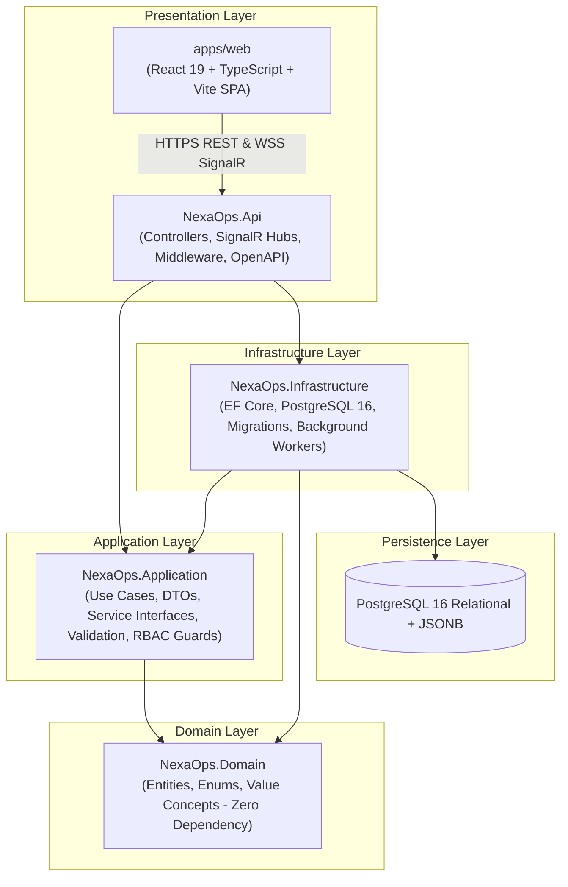

# NexaOps — Multi-Tenant Company Operations Platform

[](https://dotnet.microsoft.com/)
[](https://www.postgresql.org/)
[](https://react.dev/)
[](https://www.typescriptlang.org/)
[](https://dotnet.microsoft.com/apps/aspnet/signalr)
[](#-kết-quả-kiểm-thử--chất-lượng-mã-nguồn)
[](#-kiến-trúc-hệ-thống)

**NexaOps** là nền tảng quản trị vận hành doanh nghiệp đa tổ chức (Enterprise Multi-Tenant Operations Platform), cung cấp giải pháp toàn diện cho: Quản lý tổ chức & cơ cấu phòng ban phân cấp, Biểu mẫu động (Dynamic Form Builder Studio), Quy trình phê duyệt đa cấp (Multi-Step Approval Workflows), Theo dõi hạn chót & leo thang tự động (SLA Escalation Engine), Thông báo thời gian thực (SignalR Notifications), và Nhật ký kiểm toán bảo mật chuẩn doanh nghiệp (Audit Trail).

---

## 📑 Mục Lục
1. [Kiến Trúc Hệ Thống](#-kiến-trúc-hệ-thống)
2. [Cấu Trúc Thư Mục Dự Án](#-cấu-trúc-thư-mục-dự-án)
3. [Chi Tiết Tiến Trình Qua Từng Phase (Phase Roadmap)](#-chi-tiết-tiến-trình-qua-từng-phase)
   - [Phase 1: Solution Architecture & Infrastructure Setup](#phase-1-solution-architecture--infrastructure-setup)
   - [Phase 2: Users Module & Password Security](#phase-2-users-module--password-security)
   - [Phase 3: Authentication & JWT Engine](#phase-3-authentication--jwt-engine)
   - [Phase 4: Companies Module & Slug Generator](#phase-4-companies-module--slug-generator)
   - [Phase 5: Departments & Organizational Hierarchy](#phase-5-departments--organizational-hierarchy)
   - [Phase 6: Company Members & Invitation Workflow](#phase-6-company-members--invitation-workflow)
   - [Phase 7: Database Migration & Containerization](#phase-7-database-migration--containerization)
   - [Phase 8: Multi-Tenant Access Control & Security Isolation](#phase-8-multi-tenant-access-control--security-isolation)
   - [Phase 9: Dynamic Forms Engine & Submissions](#phase-9-dynamic-forms-engine--submissions)
   - [Phase 10: Step-Up Company Ownership Transfer](#phase-10-step-up-company-ownership-transfer)
   - [Phase 11: Multi-Tenant Audit Logging Trail](#phase-11-multi-tenant-audit-logging-trail)
   - [Phase 12: Form Analytics & Dashboard Statistics API](#phase-12-form-analytics--dashboard-statistics-api)
   - [Phase 13: Frontend Foundation & Design System Setup](#phase-13-frontend-foundation--design-system-setup)
   - [Phase 14: Dynamic Form Builder Studio & Preview UI](#phase-14-dynamic-form-builder-studio--preview-ui)
   - [Phase 15: Frontend Auth & Step-Up Ownership Transfer UI](#phase-15-frontend-auth--step-up-ownership-transfer-ui)
   - [Phase 16: Department Hierarchy Tree Explorer UI](#phase-16-department-hierarchy-tree-explorer-ui)
   - [Phase 17: Audit Trail Explorer UI & JSON Inspection](#phase-17-audit-trail-explorer-ui--json-inspection)
   - [Phase 18: Form Submissions Inbox & Review Workflow UI](#phase-18-form-submissions-inbox--review-workflow-ui)
   - [Phase 19: Company Members Manager & Invitations UI](#phase-19-company-members-manager--invitations-ui)
   - [Phase 20: Secure Authentication Session & Workspace Management](#phase-20-secure-authentication-session--workspace-management)
   - [Phase 21: Multi-Step Approval Workflows, SLA Escalation & Real-Time SignalR](#phase-21-multi-step-approval-workflows-sla-escalation--real-time-signalr)
4. [Ma Trận Phân Quyền (RBAC Matrix)](#-ma-trận-phân-quyền-rbac-matrix)
5. [Kết Quả Kiểm Thử & Chất Lượng Mã Nguồn](#-kết-quả-kiểm-thử--chất-lượng-mã-nguồn)
6. [Hướng Dẫn Cài Đặt & Khởi Chạy (Quickstart)](#-hướng-dẫn-cài-đặt--khởi-chạy-quickstart)
7. [Lộ Trình Kế Tiếp (Phase 22+)](#-lộ-trình-kế-tiếp-phase-22)

---

## 🏛️ Kiến Trúc Hệ Thống

Hệ thống được thiết kế theo nguyên lý **Clean Architecture** kết hợp **Modular Monolith**:



---

## 📁 Cấu Trúc Thư Mục Dự Án

```text
nexaops/
├── NexaOps.slnx                           # Solution file .NET 10
├── compose.yaml                           # Docker Compose (PostgreSQL 16, API)
├── Dockerfile                             # Multi-stage production container build
├── walkthrough.md                         # Tài liệu kỹ thuật chi tiết theo phase
├── src/
│   ├── NexaOps.Domain/                    # Entities, Enums, Domain Rules
│   │   ├── Entities/                      # User, Company, Department, FormDefinition, ApprovalWorkflow...
│   │   └── Enums/                         # MemberRole, SubmissionStatus, ApprovalStepType...
│   ├── NexaOps.Application/               # DTOs, Business Interfaces, Service Implementations
│   │   ├── Common/                        # Interfaces, Models, Exceptions, Access Services
│   │   ├── Auth/                          # Session DTOs & Services
│   │   ├── Companies/                     # Company CRUD & Ownership Transfer
│   │   ├── Departments/                   # Org Tree Hierarchy Services
│   │   ├── CompanyMembers/                # Member Management & Invite Token Flow
│   │   ├── Forms/                         # Dynamic Schema Validation Engine & Submissions
│   │   ├── Workflows/                     # Multi-Step Workflow Engine & Delegation
│   │   ├── Notifications/                 # In-App Notification Dispatcher
│   │   └── AuditLogs/                     # Tenant Audit Logging Trail
│   ├── NexaOps.Infrastructure/            # EF Core DbContext, Configurations, Migrations, Services
│   │   ├── Persistence/                   # ApplicationDbContext, Entity Configurations
│   │   ├── Migrations/                    # EF Core PostgreSQL Migration Snapshots
│   │   └── Services/                      # BackgroundService, Token Hasher, CurrentUser
│   └── NexaOps.Api/                       # ASP.NET Core Web API
│       ├── Controllers/                   # Thin API Controllers
│       ├── Hubs/                          # SignalR NotificationHub
│       ├── Middleware/                    # Exception Middleware (ProblemDetails RFC 7807)
│       └── Services/                      # RealtimeNotificationService SignalR Adapter
├── apps/
│   ├── web/                               # React 19 + TypeScript + Vite Single Page Application
│   │   ├── src/
│   │   │   ├── components/                # NotificationCenter, WorkflowConfigModal, SubmissionsInbox...
│   │   │   ├── context/                   # AuthContext, CompanyContext
│   │   │   ├── services/                  # api.ts, signalr.ts
│   │   │   └── types/                     # TypeScript Interfaces & Enums
│   │   └── package.json
│   └── api/                               # Legacy NestJS reference implementation
└── tests/
    ├── NexaOps.UnitTests/                 # Unit Tests
    └── NexaOps.IntegrationTests/          # 85 Scenarios Integration Tests (WebApplicationFactory + PostgreSQL)
```

---

## 🚀 Chi Tiết Tiến Trình Qua Từng Phase

### Phase 1: Solution Architecture & Infrastructure Setup
- Khởi tạo kiến trúc .NET 10 solution (`NexaOps.slnx`), phân chia ranh giới 4 tầng Clean Architecture (`Domain`, `Application`, `Infrastructure`, `Api`).
- Tích hợp `Swagger/OpenAPI` tự động sinh tài liệu API, cấu hình ASP.NET Core Health Checks (`/health`).
- Cấu hình môi trường phát triển cục bộ với Docker Compose (`compose.yaml`) cho PostgreSQL 16 Alpine.

### Phase 2: Users Module & Password Security
- Triển khai thực thể `User`, tích hợp thuật toán băm mật khẩu bảo mật `BCrypt.Net-Next` với salt ngẫu nhiên.
- Xây dựng luồng đăng ký người dùng, chống trùng lặp email, ánh xạ DTO phân tách giữa request và response.
- Thiết lập bộ kiểm thử tích hợp ban đầu cho luồng tạo tài khoản và mã hóa mật khẩu.

### Phase 3: Authentication & JWT Engine
- Xây dựng động cơ cấp phát JSON Web Token (JWT) với HMAC-SHA256, thời hạn access token và signing key an toàn.
- Triển khai `CurrentUserService` trích xuất thông tin người dùng từ `ClaimsPrincipal` (`sub`, `email`, `role`).
- Endpoint đăng nhập `POST /auth/login` trả về token xác thực và profile người dùng.

### Phase 4: Companies Module & Slug Generator
- Khởi tạo thực thể `Company` gắn liền với `OwnerId`, hỗ trợ multi-tenancy từ tầng kiến trúc.
- Bộ sinh slug tự động chuẩn hóa URL (URL-friendly Slug Generator) từ tên công ty, giải quyết xung đột slug trùng.
- Endpoint tạo công ty `POST /companies` tự động gán người tạo thành Owner đầu tiên của tổ chức.

### Phase 5: Departments & Organizational Hierarchy
- Xây dựng mô hình cây cơ cấu tổ chức phân cấp (Organizational Tree Hierarchy) với quan hệ cha-con (`ParentId`).
- Triển khai thuật toán chống vòng lặp đệ quy vô tận (circular reference prevention) khi gán phòng ban cha.
- Chỉ định Trưởng phòng (`ManagerId`) cho từng phòng ban và phân cấp quản lý trực thuộc.

### Phase 6: Company Members & Invitation Workflow
- Quản lý danh sách thành viên `CompanyMember` và ma trận vai trò nội bộ: `Owner`, `Admin`, `Manager`, `Member`.
- Cơ chế gửi lời mời qua Token mã hóa an toàn (`InviteToken`, thời hạn 7 ngày).
- Endpoint chấp nhận lời mời `POST /company-members/accept-invite`, tự động kích hoạt tài khoản thành viên trong tổ chức.

### Phase 7: Database Migration & Containerization
- Tạo migration nền tảng đầu tiên `InitialCreate` cho toàn bộ các thực thể cốt lõi trên PostgreSQL.
- Cấu hình cơ chế tự động chạy migration khi khởi động ứng dụng trong môi trường container/development.
- Đóng gói Dockerfile đa tầng (Multi-stage build) tối ưu dung lượng image runtime.

### Phase 8: Multi-Tenant Access Control & Security Isolation
- Triển khai dịch vụ phân quyền tập trung `ICompanyAccessService` / `CompanyAccessService`.
- Bảo đảm ranh giới tenant: mọi thao tác đọc/ghi bắt buộc phân giải `CompanyId` và kiểm tra quyền hạn trước khi truy cập dữ liệu.
- Ngăn chặn hoàn toàn truy vấn rò rỉ dữ liệu chéo (cross-tenant leakage), trả về HTTP 403 Forbidden chuẩn ProblemDetails.

### Phase 9: Dynamic Forms Engine & Submissions
- Xây dựng Dynamic Form Studio: định nghĩa biểu mẫu động lưu trong PostgreSQL mà không làm thay đổi cấu trúc bảng.
- Hỗ trợ các kiểu trường phong phú: `Text`, `Number`, `Email`, `Date`, `Select`, `Checkbox`.
- **Validation Engine phía Server**: Kiểm tra dynamic payload JSONB dựa trên schema định nghĩa (kiểm tra bắt buộc, độ dài, khoảng giá trị, định dạng regex).
- Quản lý vòng đời biểu mẫu: `Draft -> Published -> Archived` và tiếp nhận bài nộp `FormSubmission`.

### Phase 10: Step-Up Company Ownership Transfer
- Tính năng chuyển nhượng quyền sở hữu công ty (Company Ownership Transfer) tối quan trọng.
- **Step-Up Password Verification**: Bắt buộc chủ sở hữu hiện tại nhập lại mật khẩu tài khoản để xác minh danh tính.
- Giao dịch nguyên tử (Atomic Database Transaction): Cập nhật `Company.OwnerId`, thăng cấp người nhận thành Owner và hạ cấp chủ cũ xuống Admin trong cùng một transaction; hoàn tác nếu gặp sự cố.

### Phase 11: Multi-Tenant Audit Logging Trail
- Xây dựng thực thể `AuditLog` ghi nhận toàn bộ đột biến quan trọng trong từng tổ chức.
- Lưu trữ ngữ cảnh đầy đủ: `CompanyId`, `ActorId`, `Action`, `EntityType`, `EntityId`, `DetailsJson` (dạng PostgreSQL JSONB), `IpAddress`, `UserAgent`, `CreatedAt`.
- Đánh chỉ mục hiệu năng cao trên `(CompanyId, CreatedAt)`, `(CompanyId, Action)`, `(CompanyId, ActorId)`. Phân quyền xem nhật ký chỉ dành riêng cho Owner và Admin.

### Phase 12: Form Analytics & Dashboard Statistics API
- Cung cấp API tổng hợp dữ liệu thống kê theo thời gian thực: tổng số biểu mẫu, tổng bài nộp, tỷ lệ phê duyệt, phân bố trạng thái (`Pending`, `Approved`, `Rejected`).
- Thống kê tỷ lệ nộp đơn theo phòng ban và theo dõi xu hướng tiếp nhận theo chu kỳ thời gian.

### Phase 13: Frontend Foundation & Design System Setup
- Khởi tạo Single Page Application bằng **React 19**, **TypeScript** và **Vite**.
- Xây dựng hệ thống giao diện tối ưu (Dark Mode Design System), bố cục thẻ kính mờ (Glassmorphism), hiệu ứng chuyển cảnh mượt mà và responsive đa thiết bị.

### Phase 14: Dynamic Form Builder Studio & Preview UI
- Giao diện trực quan cho phép thêm/sửa/xóa các trường dữ liệu động.
- Tính năng **Live Preview**: Cho phép xem trước giao diện biểu mẫu thực tế ngay trong lúc thiết kế và thử nghiệm nhập liệu.
- Modal nộp form cho thành viên công ty với phản hồi trực quan khi dữ liệu vi phạm ràng buộc.

### Phase 15: Frontend Auth & Step-Up Ownership Transfer UI
- Hộp thoại Đăng nhập / Đăng ký hiện đại, tự động kiểm tra tính hợp lệ của mật khẩu và email.
- Modal chuyển nhượng quyền sở hữu tích hợp bước xác nhận mật khẩu (Step-up Dialog), cảnh báo rủi ro trực quan và danh sách thành viên đủ điều kiện tiếp nhận quyền sở hữu.

### Phase 16: Department Hierarchy Tree Explorer UI
- Giao diện trực quan hóa cây cơ cấu tổ chức phân cấp dạng đệ quy (Recursive Hierarchy Tree).
- Thao tác nhanh: tạo phòng ban con, gán Trưởng phòng ban (Department Manager) từ danh sách thành viên thực tế, hiển thị số lượng nhân sự trực thuộc.

### Phase 17: Audit Trail Explorer UI & JSON Inspection
- Trình khám phá nhật ký kiểm toán với bộ lọc linh hoạt theo Hành động (Action), Loại thực thể (Entity Type) và ngày tháng.
- Xem chi tiết payload `DetailsJson` được định dạng JSON đẹp mắt, dễ dàng kiểm tra các thay đổi dữ liệu nhạy cảm.

### Phase 18: Form Submissions Inbox & Review Workflow UI
- Hộp thư đến quản lý toàn bộ hồ sơ nộp của tổ chức với bộ lọc trạng thái.
- Hộp thoại xem chi tiết nội dung đã nộp kèm thông tin người gửi, thời gian gửi.
- Thao tác phê duyệt (Approve) hoặc từ chối (Reject) kèm ghi chú xét duyệt (Review Notes).

### Phase 19: Company Members Manager & Invitations UI
- Giao diện quản lý danh sách nhân sự trong tổ chức: hiển thị huy hiệu vai trò (`Owner`, `Admin`, `Manager`, `Member`), trạng thái kích hoạt.
- Thao tác thăng cấp/hạ cấp vai trò thành viên (Role Assignment).
- Luồng tạo link mời vào tổ chức (Invite Link Modal) kèm tính năng sao chép 1-click tiện lợi.

### Phase 20: Secure Authentication Session & Workspace Management
- **Production-Grade Session Hardening**:
  - Giảm thời hạn Access Token xuống 15 phút (short-lived JWT).
  - Refresh Token sinh ngẫu nhiên 64 bytes cryptographic entropy, băm một chiều **SHA-256** lưu trong database (`refresh_tokens`), tuyệt đối không lưu plaintext.
  - Quản lý tự động qua HTTP Cookie: `HttpOnly = true`, `Secure = true`, `SameSite = Lax`, `Path = /auth`.
  - Client-side: Access token chỉ nằm trong bộ nhớ RAM (In-Memory Closure), **Zero Web Storage** (không lưu token trong `localStorage`).
  - Cơ chế **Single-Use Rotation**: Refresh token cũ bị thu hồi ngay sau khi dùng.
  - Cơ chế **Token Family Breach Detection**: Tự động thu hồi toàn bộ phiên đăng nhập của người dùng nếu phát hiện token cũ bị tái sử dụng (chống tấn công replay attack).
  - **Mutex Refresh Queue** trên Frontend: Xếp hàng các request đồng thời khi gặp lỗi 401, refresh token duy nhất một lần và retry toàn bộ hàng đợi, giải quyết triệt để lỗi refresh token loop.
- **Company Workspace Switcher**: Quản lý danh sách tổ chức, chuyển đổi không gian làm việc mượt mà trên thanh Navbar, xóa sạch cache tenant cũ để chống rò rỉ dữ liệu chéo.

### Phase 21: Multi-Step Approval Workflows, SLA Escalation & Real-Time SignalR
- **Mô Hình Dữ Liệu & Entity Framework Core**:
  - `approval_workflows`: Định nghĩa quy trình phê duyệt gắn với từng biểu mẫu.
  - `approval_steps`: Danh sách các bước duyệt tuần tự (`OrderIndex`, `Name`, `StepType`, `ApproverRole`, `SpecificApproverUserId`, `TimeLimitHours`, `AllowSelfApproval`).
  - `submission_approval_steps`: Snapshot bất biến lưu vết toàn bộ tiến trình duyệt khi nộp hồ sơ.
  - `notifications`: Lưu trữ thông báo trong hệ thống.
  - Migration: `20261014131847_AddApprovalWorkflowsAndNotifications`.
- **Động Cơ Phê Duyệt Tuần Tự (Multi-Step Engine)**:
  - Máy trạng thái hồ sơ: `Pending -> InReview -> Approved / Rejected`.
  - Ép buộc thứ tự duyệt tuần tự (Sequential Steps): Chỉ bước ở thứ tự `CurrentStepOrder` mới được xử lý.
  - **Self-Approval Guard**: Chặn người nộp tự duyệt hồ sơ của mình khi `AllowSelfApproval = false` (HTTP 403 Forbidden).
  - Ma trận phê duyệt: Hỗ trợ `CompanyOwner`, `DepartmentManager`, `Role` cấp bậc, và `SpecificUser`.
  - Khi duyệt bước cuối: Chuyển toàn bộ hồ sơ thành `Approved`. Khi từ chối bất kỳ bước nào: Chấm dứt hồ sơ với `Rejected`, đánh dấu các bước sau thành `Skipped`.
- **Ủy Quyền Bước Duyệt (Step Delegation)**:
  - Cho phép người duyệt hiện tại hoặc Admin/Owner ủy quyền bước cho thành viên khác trong cùng công ty (`POST /submissions/{id}/steps/{order}/delegate`).
  - Chống gian lận: Không cho phép ủy quyền cho chính người nộp đơn. Ghi nhận audit log và gửi thông báo cho người nhận ủy quyền.
- **Quản Lý Hạn SLA & Dịch Vụ Nền Tự Động Leo Thang**:
  - Tính toán hạn chót `due_date` và cờ tính toán `isOverdue`.
  - **`WorkflowSlaEscalationBackgroundService`**: Chạy định kỳ mỗi **2 phút**, tự động quét toàn bộ công ty có bước quá hạn SLA (`DueDate < now && !IsEscalated`).
  - Đánh dấu `is_escalated = true`, gắn tag `[SLA LEO THANG]`, cảnh báo khẩn cấp tới Owner, Admins và người duyệt được phân công.
  - Ghi nhật ký kiểm toán hệ thống an toàn (`actor_id = null`) không gây lỗi Foreign Key.
- **Hệ Thống Thông Báo Thời Gian Thực (SignalR Real-Time Hub)**:
  - `NotificationHub` tại `/hubs/notifications` với xác thực JWT Bearer.
  - Phân nhóm người dùng `user_{userId}` và công ty `company_{companyId}`.
  - Bắn sự kiện thời gian thực `ReceiveNotification` và `WorkflowStepUpdated`.
  - Frontend SignalR Client tự động kết nối lại (`automaticReconnect`), đồng bộ trạng thái stepper timeline ngay khi có thay đổi.
- **Giao Diện Quản Trị Quy Trình & Trung Tâm Thông Báo**:
  - `NotificationCenter`: Chuông thông báo trên Navbar, huy hiệu số lượng chưa đọc động, menu lọc, đánh dấu đã đọc / xóa thông báo.
  - `WorkflowConfigModal`: Trình thiết kế quy trình đa cấp trực quan cho biểu mẫu.
  - `FormSubmissionsInbox`: Stepper timeline hiển thị trạng thái từng bước, huy hiệu SLA, cảnh báo trễ hạn, form ủy quyền bước, modal phân tích SLA & điểm nghẽn quy trình (`WorkflowAnalytics`).

---

## 🛡️ Ma Trận Phân Quyền (RBAC Matrix)

| Chức Năng / Thao Tác | Owner | Admin | Manager | Member | Khách (Guest) |
| :--- | :---: | :---: | :---: | :---: | :---: |
| **Xem Danh Sách & Nộp Biểu Mẫu** | ✅ | ✅ | ✅ | ✅ | ❌ |
| **Thiết Kế Form & Cấu Hình Workflow** | ✅ | ✅ | ❌ | ❌ | ❌ |
| **Phê Duyệt Hồ Sơ (Theo vai trò được phân công)** | ✅ | ✅ | ✅ | ❌ | ❌ |
| **Ủy Quyền Bước Phê Duyệt (Delegation)** | ✅ | ✅ | ✅ (nếu là người duyệt) | ❌ | ❌ |
| **Kích Hoạt Quét Leo Thang SLA Thủ Công** | ✅ | ✅ | ❌ | ❌ | ❌ |
| **Quản Lý Phòng Ban & Cơ Cấu Cây** | ✅ | ✅ | ✅ (tạo/sửa) | ❌ | ❌ |
| **Xóa Phòng Ban** | ✅ | ✅ | ❌ | ❌ | ❌ |
| **Mời Thành Viên & Phân Bổ Vai Trò** | ✅ | ✅ | ❌ | ❌ | ❌ |
| **Xem Nhật Ký Kiểm Toán (Audit Logs)** | ✅ | ✅ | ❌ | ❌ | ❌ |
| **Chuyển Giao Quyền Sở Hữu Công Ty (Step-up)**| ✅ (duy nhất) | ❌ | ❌ | ❌ | ❌ |
| **Cập Nhật & Xóa Công Ty** | ✅ | ❌ | ❌ | ❌ | ❌ |

---

## 🧪 Kết Quả Kiểm Thử & Chất Lượng Mã Nguồn

Hệ thống tuân thủ nghiêm ngặt nguyên tắc **"Testing Is Part of the Feature"** (Kiểm thử là một phần của tính năng). Mọi thay đổi logic đều có kịch bản test tích hợp cả chiều dương (positive) lẫn chiều âm (negative):

### 1. Backend Integration Tests (`dotnet test`)
```text
Passed!  - Failed: 0, Passed: 85, Skipped: 0, Total: 85, Duration: 5 s - NexaOps.IntegrationTests.dll (net10.0)
```
- **Tỷ Lệ Đạt**: **100% (85/85 tests passed)**.
- **Các bộ test chính**:
  - `AuthApiTests` (Xác thực JWT cơ bản, đăng ký, đăng nhập).
  - `AuthSessionApiTests` (Xoay vòng refresh token, thu hồi session, cookie HttpOnly, chống replay token family).
  - `CompaniesApiTests` (Tạo, cập nhật công ty, sinh slug duy nhất).
  - `CompanyAccessTests` (Cô lập dữ liệu multi-tenant, chặn truy cập chéo giữa các công ty).
  - `CompanyMembersApiTests` (Mời thành viên, chấp nhận token mời, gán vai trò).
  - `CompanyOwnershipTransferTests` (Chuyển quyền sở hữu, kiểm tra mật khẩu, rollback nguyên tử).
  - `DepartmentsApiTests` (Cây phòng ban, chống đệ quy vòng lặp, gán trưởng phòng).
  - `FormsApiTests` (Dynamic Form Studio, validation engine JSONB, nộp đơn).
  - `AuditLogsApiTests` (Ghi nhận nhật ký đột biến nhạy cảm, bảo vệ quyền xem log).
  - `ApprovalWorkflowTests` (11 kịch bản: phê duyệt tuần tự, chặn tự duyệt, từ chối dừng chuỗi, ủy quyền bước, quét hạn SLA và sweep tự động của background worker).

### 2. Frontend Production Build (`npm --prefix apps/web run build`)
```text
> tsc -b && vite build
✓ 1924 modules transformed.
dist/index.html                   0.45 kB │ gzip:   0.28 kB
dist/assets/index-D2xyolEv.css    9.81 kB │ gzip:   2.86 kB
dist/assets/index-DgJCSybj.js   533.27 kB │ gzip: 137.98 kB
✓ built in 788ms
```
- **0 lỗi TypeScript (`tsc -b`)**, chuẩn hóa dependencies và React Hooks với `useCallback`.

---

## 💻 Hướng Dẫn Cài Đặt & Khởi Chạy (Quickstart)

### Yêu Cầu Môi Trường
- [.NET 10 SDK](https://dotnet.microsoft.com/download)
- [Node.js 20+](https://nodejs.org/) & [pnpm](https://pnpm.io/)
- [Docker & Docker Compose](https://www.docker.com/)

### 1. Khởi động Cơ sở dữ liệu PostgreSQL
```bash
docker compose up -d postgres
```

### 2. Chạy Backend API
```bash
dotnet restore
dotnet build
dotnet run --project src/NexaOps.Api
```
- API chạy tại: `https://localhost:5001` (hoặc `http://localhost:5000`)
- Swagger UI tài liệu API: `https://localhost:5001/swagger`
- SignalR Notification Hub: `https://localhost:5001/hubs/notifications`

### 3. Chạy Toàn Bộ Kiểm Thử Tích Hợp
```bash
dotnet test
```

### 4. Khởi động Frontend Web Application
```bash
cd apps/web
pnpm install
pnpm dev
```
- Ứng dụng Web mở tại: `http://localhost:5173`

---

## 🔮 Lộ Trình Kế Tiếp (Phase 22+)

1. **Conditional Approval Branching (Quy Trình Duyệt Rẽ Nhánh Điều Kiện)**:
   - Hỗ trợ định nghĩa quy tắc logic dựa trên giá trị trường động (ví dụ: *Nếu số tiền thanh toán > 50,000,000 VND -> tự động kích hoạt thêm bước duyệt của Giám đốc Tài chính*).
2. **Audit / PDF Certificate Export (Xuất Báo Cáo Hồ Sơ Kèm Con Dấu Điện Tử)**:
   - Cho phép xuất hồ sơ đã hoàn thành phê duyệt ra định dạng PDF chuẩn hóa, kèm nhật ký tiến trình từng bước, người duyệt và timestamp có chữ ký số.
3. **External Notification Adapters (Email & Webhook Integrations)**:
   - Tích hợp cổng gửi email qua SMTP/SendGrid và webhook thông báo tới Slack/Teams khi hồ sơ quá hạn SLA cần xử lý khẩn cấp.

---

*Tài liệu được cập nhật tự động và đồng bộ với phiên bản mã nguồn mới nhất của NexaOps.*

