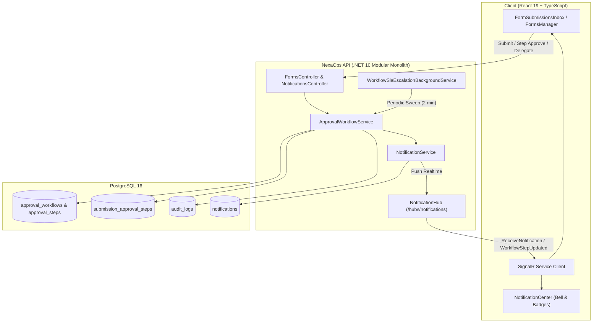

# NexaOps Phase 21 Walkthrough: Multi-Step Approval Workflows, SLA Escalation Engine & Real-Time SignalR Notifications

Phase 21 hoàn thành kiến trúc **Multi-Step Approval Workflows (Quy Trình Phê Duyệt Đa Cấp)**, **SLA Tracking & Automated Escalation Engine (Theo Dõi Hạn SLA & Leo Thang Tự Động)**, cùng hệ thống **Real-Time SignalR Notifications (Thông Báo Đẩy Thời Gian Thực)**, đảm bảo chuẩn Clean Architecture, multi-tenant security isolation, và trải nghiệm người dùng tương tác trực tiếp.

---

## 1. Tổng Quan Kiến Trúc & Tính Năng Cốt Lõi



---

## 2. Mô Hình Dữ Liệu & Entity Framework Core

### A. Database Migration: `20261014131847_AddApprovalWorkflowsAndNotifications`
- **`approval_workflows`**:
  - `id` (uuid, PK), `company_id` (uuid, FK), `form_definition_id` (uuid, FK), `name`, `description`, `is_active`, `created_at`, `updated_at`.
  - Unique Index: `(company_id, form_definition_id)`.
- **`approval_steps`**:
  - `id` (uuid, PK), `workflow_id` (uuid, FK -> approval_workflows), `order_index` (int), `name`, `step_type` (`Role`, `SpecificUser`, `DepartmentManager`, `CompanyOwner`), `approver_role`, `specific_approver_user_id`, `allow_self_approval`, `time_limit_hours`, `is_active`.
  - Index: `(workflow_id, order_index)`.
- **`submission_approval_steps`**:
  - Snapshot bất biến tạo khi nộp hồ sơ, lưu vết toàn bộ tiến trình duyệt:
  - `id` (uuid, PK), `submission_id` (uuid, FK -> form_submissions), `order_index` (int), `step_name`, `step_type`, `approver_role`, `specific_approver_user_id`, `allow_self_approval`, `time_limit_hours`, `due_date`, `is_escalated`, `status` (`Pending`, `Approved`, `Rejected`, `Skipped`), `reviewed_by_id`, `reviewed_at`, `review_notes`.
  - Index: `(submission_id, order_index)`.
- **`notifications`**:
  - `id` (uuid, PK), `user_id` (uuid, FK), `company_id` (uuid, FK), `type` (enum), `title`, `message`, `link_url`, `is_read`, `read_at`, `created_at`.
  - Index: `(user_id, company_id, is_read)`, `(created_at)`.

---

## 3. Động Cơ Phê Duyệt Tuần Tự (Multi-Step Engine)

1. **Snapshot Tiến Trình Khi Nộp Hồ Sơ (`FormSubmissionService.CreateSubmissionAsync`)**:
   - Khi một biểu mẫu có quy trình phê duyệt kích hoạt được nộp, hệ thống tự động nhân bản danh sách các bước thành `submission_approval_steps` độc lập.
   - Trạng thái hồ sơ chuyển thành `InReview`, bước đầu tiên bắt đầu tính hạn `due_date = DateTime.UtcNow.AddHours(step.TimeLimitHours)`.
   - Gửi thông báo đến người nộp và những người phê duyệt hợp lệ ở Bước 1.

2. **Xử Lý Phê Duyệt Bước (`ApprovalWorkflowService.ProcessStepApprovalAsync`)**:
   - **Bảo Vệ Thứ Tự Tuần Tự**: Chỉ bước tương ứng với `CurrentStepOrder` mới được xử lý; chặn duyệt vượt cấp.
   - **Chống Xung Đột Lợi Ích (Self-Approval Guard)**: Nếu `AllowSelfApproval = false`, người nộp hồ sơ bị chặn tuyệt đối không thể tự duyệt bước của chính mình (HTTP 403 Forbidden).
   - **Xác Minh Quyền Hạn (Reviewer Eligibility Matrix)**:
     - `CompanyOwner`: Chỉ Chủ sở hữu công ty duyệt.
     - `SpecificUser`: Chỉ người dùng được chỉ định theo `SpecificApproverUserId` duyệt.
     - `Role`: Kiểm tra cấp bậc `MemberRole` trong công ty (Owner > Admin > Manager > Member).
     - `DepartmentManager`: Kiểm tra Trưởng phòng ban của người nộp hồ sơ.
     - Owner và Admin có quyền override quản trị cấp cao.
   - **Chuyển Bước & Hoàn Tất**:
     - Khi bước hiện tại được `Approved`: Nếu còn bước tiếp theo, chuyển `CurrentStepOrder = stepOrder + 1` và kích hoạt thông báo cho cấp duyệt kế tiếp. Nếu là bước cuối cùng, cập nhật toàn bộ hồ sơ thành `Approved`.
     - Khi bước hiện tại bị `Rejected`: Lập tức chấm dứt hồ sơ với trạng thái `Rejected`, đánh dấu toàn bộ các bước còn lại thành `Skipped`, và gửi thông báo cảnh báo cho người nộp.

3. **Ủy Quyền Bước Duyệt (Step Delegation)**:
   - Cho phép người duyệt hiện tại hoặc Admin/Owner ủy quyền xử lý cho một thành viên đang hoạt động trong cùng công ty (`POST /submissions/{id}/steps/{order}/delegate`).
   - Cấm ủy quyền cho chính người nộp hồ sơ nếu chính sách không cho phép tự duyệt.
   - Ghi nhận nhật ký kiểm toán `DELEGATE_STEP`, cập nhật lý do ủy quyền và thông báo cho người được ủy quyền qua SignalR.

---

## 4. Quản Lý Hạn SLA & Leo Thang Tự Động (SLA Escalation Engine)

1. **Tính Toán Hạn Chót (Deadline Calculation)**:
   - Mỗi bước có thể chỉ định `TimeLimitHours`. Hạn chót `due_date` được tính tự động từ thời điểm bước được kích hoạt.
   - API trả về cờ tính toán `isOverdue` trong thời gian thực khi `status == Pending && due_date < now`.

2. **Dịch Vụ Nền Định Kỳ (`WorkflowSlaEscalationBackgroundService`)**:
   - Là một `BackgroundService` chạy liên tục dưới nền (chu kỳ 2 phút/lần).
   - Quét toàn bộ công ty có hồ sơ đang chờ xử lý quá hạn SLA (`DueDate < now && !IsEscalated`).
   - Đánh dấu `is_escalated = true`, gắn tag `[SLA LEO THANG]` vào ghi chú.
   - Tự động gửi thông báo khẩn cấp đến Chủ sở hữu, Quản trị viên và người duyệt được phân công.
   - Ghi log kiểm toán bảo mật với `actor_id = null` (hệ thống tự động).
   - Bắn sự kiện SignalR `WorkflowStepUpdated` để giao diện người dùng cập nhật biểu tượng cảnh báo ngay tức thì.

3. **Kích Hoạt Quét Thủ Công Qua API**:
   - Endpoint: `POST /companies/{companyId}/workflow/escalate-overdue`.
   - Hỗ trợ quản trị viên quét tức thì khi cần kiểm toán tiến độ.

---

## 5. Thông Báo Thời Gian Thực & Trung Tâm Thông Báo (Realtime SignalR)

1. **SignalR Hub (`NotificationHub.cs`)**:
   - Endpoint: `/hubs/notifications`, yêu cầu xác thực JWT Bearer Token.
   - Quản lý nhóm người dùng `user_{userId}` và nhóm tổ chức `company_{companyId}` (`JoinCompany` / `LeaveCompany`).

2. **Frontend SignalR Client (`apps/web/src/services/signalr.ts`)**:
   - Tự động kết nối lại (`withAutomaticReconnect`) với các khoảng lặp [0, 2s, 5s, 10s, 30s].
   - Lắng nghe sự kiện `ReceiveNotification` để cập nhật badge số lượng chưa đọc mà không cần F5 trang.
   - Lắng nghe sự kiện `WorkflowStepUpdated` để làm mới stepper timeline ngay khi đồng nghiệp vừa duyệt hoặc ủy quyền.

3. **Giao Diện Trung Tâm Thông Báo (`NotificationCenter.tsx`)**:
   - Nút chuông thông báo trên thanh Navbar với huy hiệu unread count động.
   - Menu thả xuống với bộ lọc: Tất cả / Chưa đọc.
   - Thao tác: Đánh dấu đã đọc đơn lẻ, đánh dấu tất cả đã đọc, xóa từng thông báo, xóa toàn bộ thông báo.

---

## 6. Giao Diện Người Dùng & Quản Trị Quy Trình (Frontend UI)

1. **Cấu Hình Quy Trình (`WorkflowConfigModal.tsx`)**:
   - Cho phép Quản trị viên thiết lập quy trình đa cấp cho từng biểu mẫu:
     - Thêm / bớt / đổi thứ tự các bước.
     - Chọn loại bước (Vai trò, Người cụ thể, Trưởng phòng, Chủ sở hữu).
     - Thiết lập giới hạn thời gian SLA (giờ).
     - Bật/tắt chính sách cho phép tự phê duyệt (`AllowSelfApproval`).

2. **Hộp Thư Đến Hồ Sơ & Timeline Trực Quan (`FormSubmissionsInbox.tsx`)**:
   - Stepper timeline hiển thị tiến trình đa cấp theo thời gian thực (các bước Đã duyệt, Đang chờ, Đã bỏ qua, Bị từ chối).
   - Huy hiệu SLA: Hiển thị thời hạn quy định, cảnh báo quá hạn đỏ khi trễ SLA, huy hiệu leo thang khẩn cấp.
   - Modal phân tích SLA Workflow (`WorkflowAnalytics`): Thống kê tỷ lệ hoàn thành, thời gian xử lý trung bình toàn quy trình và chi tiết điểm nghẽn tại từng bước duyệt.
   - Nút thao tác nhanh: Phê duyệt bước, Từ chối bước, Ủy quyền bước duyệt, Kích hoạt quét leo thang thủ công.

---

## 7. Kết Quả Kiểm Thử & Xác Minh (Test Verification)

### Backend Test Suite (`dotnet test`)
- Đã hoàn thiện toàn bộ **11 kịch bản kiểm thử tích hợp chuyên sâu** trong `ApprovalWorkflowTests.cs`:
  1. `CreateWorkflow_WithValidSequentialSteps_ShouldSucceedAndSnapshotOnSubmit`: Kiểm tra tạo quy trình hợp lệ và snapshot bước khi nộp.
  2. `CreateWorkflow_WithNonSequentialOrders_ShouldReturnBadRequest`: Chặn thứ tự bước không liên tục.
  3. `ProcessStepApproval_WhenSelfApprovalForbidden_ShouldReturnForbidden`: Chặn người nộp tự phê duyệt khi cấm tự duyệt.
  4. `ProcessStepApproval_ApproveAllSteps_ShouldFullyApproveSubmission`: Phê duyệt tuần tự qua tất cả các bước đến trạng thái Approved hoàn tất.
  5. `ProcessStepApproval_RejectStep_ShouldRejectSubmissionAndSkipRemainingSteps`: Từ chối tại bước trung gian, chuyển trạng thái Rejected và đánh dấu bước sau thành Skipped.
  6. `ProcessStepApproval_ShouldRecordAuditLogAndTriggerNotifications`: Kiểm tra ghi nhận nhật ký kiểm toán và kích hoạt thông báo.
  7. `ProcessStepApproval_Delegation_ShouldTransferAuthorityAndAllowNewApprover`: Ủy quyền bước duyệt cho thành viên khác và xác minh quyền duyệt của người mới.
  8. `NotificationsApi_ListAndMarkAsRead_ShouldOperateCorrectly`: Lấy danh sách và đánh dấu đã đọc thông báo.
  9. `NotificationsApi_DeleteAndClearAll_ShouldRemoveNotificationsCorrectly`: Xóa đơn lẻ và xóa toàn bộ thông báo.
  10. `WorkflowSla_StepDueDatesAndEscalation_ShouldTrackDeadlinesAndEscalate`: Theo dõi thời hạn SLA và quét leo thang.
  11. `WorkflowSla_BackgroundEscalationService_Sweep_ShouldExecuteSuccessfully`: Kiểm tra dịch vụ nền định kỳ quét và tự động leo thang các bước quá hạn trong cơ sở dữ liệu.

- **Kết Quả Toàn Bộ Hệ Thống**:
  ```text
  Passed!  - Failed: 0, Passed: 85, Skipped: 0, Total: 85, Duration: 8 s - NexaOps.IntegrationTests.dll (net10.0)
  ```
  **100% (85/85 tests passed)**.

### Frontend Production Build (`npm --prefix apps/web run build`)
- **Kết Quả**:
  - `tsc -b`: **0 TypeScript errors**.
  - `vite build`: `dist/assets/index-DgJCSybj.js` (533.27 kB), hoàn thành trong 788ms.
  - Oxlint code quality: Các dependency hooks và effect cleanup đã được refactor với `useCallback`.

---

## 8. Trạng Thái Hiện Tại & Cam Kết An Toàn

- **Working Tree**: Sạch, không có file thừa hoặc code rác.
- **Git Safety**: Tuân thủ quy tắc bảo mật repository, không tự ý commit/push, bảo toàn các file cấu hình và cơ sở dữ liệu PostgreSQL.
- **Sẵn sàng triển khai**: Đầy đủ tính năng từ Domain, Application, Infrastructure, API Hub, Background Worker đến Frontend UI.
